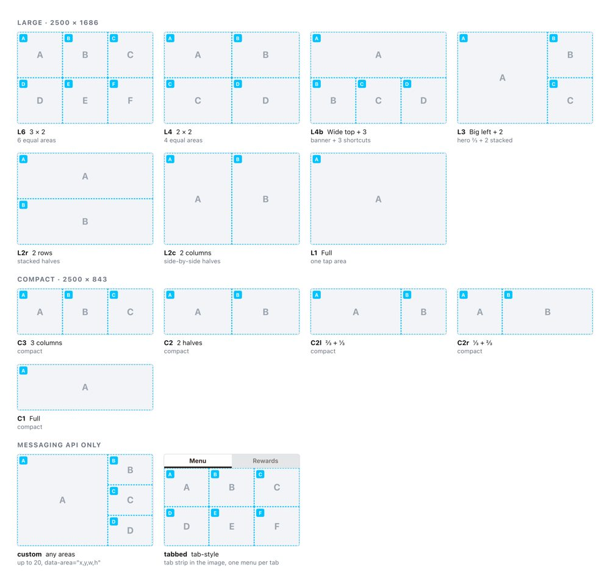

# Social Mockup Studio

**Realistic LINE, Facebook and TikTok mockups for any brand, on iPhone, Android and desktop, made by Claude.**

You describe the campaign in plain words. Claude asks you a few questions, finds real photos, builds the screens so they look like real app screenshots, and gives you ready-to-use images (PNG) for your slides.


---

## Contents

1. [What you can make](#1-what-you-can-make)
2. [Which Claude are you using?](#2-which-claude-are-you-using)
3. [Set up in the Claude app (Desktop, web, Cowork)](#3-set-up-in-the-claude-app-desktop-web-cowork)
4. [Set up in Claude Code](#4-set-up-in-claude-code)
5. [How to use it, step by step](#5-how-to-use-it-step-by-step)
6. [The questions Claude will ask you](#6-the-questions-claude-will-ask-you)
7. [Getting your images](#7-getting-your-images)
8. [Asking for changes](#8-asking-for-changes)
9. [Tips for the best results](#9-tips-for-the-best-results)
10. [Troubleshooting](#10-troubleshooting)
11. [Good to know (usage rules)](#11-good-to-know-usage-rules)
12. [For the people who maintain this skill](#12-for-the-people-who-maintain-this-skill)

---

## 1. What you can make

| Platform | Screens | iPhone | Android | Desktop |
|---|---|---|---|---|
| **LINE** | Official Account chat, Flex message cards, promo images (rich messages), rich menus (all 12 official layouts plus tab style), lock-screen notifications | ✓ | ✓ | – |
| **Facebook** | Feed ad (single image), carousel, Stories, the home feed on facebook.com | ✓ | ✓ | ✓ |
| **TikTok** | For You in-feed ad, Spark Ad, product card ad, tiktok.com | ✓ | ✓ | ✓ |

What makes these look real:
- **Phone frames** are drawn to the real iPhone 17 Pro and Samsung Galaxy S26 sizes.
- **App screens** (header, buttons, fonts, spacing) are matched to real 2026 screenshots of each app.
- **Fonts** are the ones each app actually uses: SF Pro and Thonburi on iPhone, Roboto on Android, TikTok's own font in TikTok.
- **Image shapes** are correct for each placement. For example, a Facebook feed image is 4:5 portrait and a TikTok video fills the whole screen.
- **Photos are real.** Your brand's photos are used if you have them. If not, Claude finds suitable photos online.
- **Thai or English copy**, with correct Thai line breaks.

All the rich-menu layouts Claude can make:



---

## 2. Which Claude are you using?

| You use… | Follow | What you get |
|---|---|---|
| The **Claude app** on Mac/Windows, or **claude.ai** in the browser | [Section 3](#3-set-up-in-the-claude-app-desktop-web-cowork) | Claude chats with you and produces the screens in its built-in workspace |
| **Cowork** (Claude doing tasks on your computer) | [Section 3](#3-set-up-in-the-claude-app-desktop-web-cowork) | Same as above. Files can go straight into a folder on your computer |
| **Claude Code** (the terminal / coding tool) | [Section 4](#4-set-up-in-claude-code) | The best quality: exact iPhone fonts when run on a Mac, and full control over the files |

Not sure? If you chat with Claude in a normal window, use Section 3.

---

## 3. Set up in the Claude app (Desktop, web, Cowork)

You do this **once**. It takes about 2 minutes.

### Step 1: Get the skill file
Ask your team lead for **`social-mockup-studio.skill`**, or copy it from the shared folder. It's a normal file you can download. If your computer can't open a `.skill` file, rename it to `social-mockup-studio.zip`; that's what it is inside.

### Step 2: Turn on file creation
1. Open Claude and go to **Settings → Capabilities**.
2. Turn on **"Code execution and file creation"**. Newer versions call it **"Create and edit files"**.

> On a **Team or Enterprise** plan, your company admin may need to allow skills first: **Organization settings → Plugins & skills → Policy**, then turn on code execution, file creation and Skills.

### Step 3: Upload the skill
1. Go to **Customize → Skills**.
2. Click **+**, then **+ Create skill**, then **Upload a skill**.
3. Choose the file from Step 1 (`.skill` or `.zip`).
4. Make sure the switch next to **social-mockup-studio** is **on**.

### Step 4 (recommended): Allow internet access
Claude uses the internet to find photos and fonts. If your settings have network or web access options for code, allow them. Without internet, Claude can still build the screens, but it will ask you to provide all the photos yourself.

### Step 5: Try it
Start a **new chat** (or a new Cowork task) and type:

> Make a LINE OA mockup on iPhone for a coffee brand called Morrow Coffee: a morning promo message with the rich menu open.

Claude should reply with questions. That means the skill is working. 🎉

---

## 4. Set up in Claude Code

You do this once on each computer.

1. Copy the skill folder into your personal skills folder:
   ```bash
   cp -R social-mockup-studio ~/.claude/skills/
   ```
   To share it with a whole project, put it in `<your-repo>/.claude/skills/` and commit it.
2. Install the screenshot tool. This needs Node.js 18 or newer; Google Chrome is used automatically if it's installed.
   ```bash
   cd ~/.claude/skills/social-mockup-studio/scripts && npm install
   ```
3. Optional: get better stock photos by adding free API keys to your shell profile:
   ```bash
   export PEXELS_API_KEY=...        # free at pexels.com/api
   export UNSPLASH_ACCESS_KEY=...   # free at unsplash.com/developers
   ```
4. Start Claude Code and just ask, for example *"mock up a TikTok ad for our new drink on Android"*, or type `/social-mockup-studio`.

> **Tip:** run it on a **Mac** for final client files. Only macOS has the real iPhone fonts (SF Pro and Thonburi). On Windows or Linux, iPhone screens use a close look-alike font.

---

## 5. How to use it, step by step

**1. Ask in plain words.** You don't need to say "skill" or "mockup". For example:
- *"Show how our LINE broadcast for the 11.11 sale will look on iPhone and Android."*
- *"I need a Facebook feed ad and a Story for Brand X, Thai copy, for a pitch tomorrow."*
- *"Visualise our CRM journey: welcome message, coupon reminder and birthday message on LINE."*
- *"Make a TikTok product card ad on iPhone using this product photo"* (attach the photo).

**2. Answer Claude's questions.** Claude asks a few at a time, usually as clickable choices. If you're not sure, pick the option marked **(Recommended)**. See the full list in [Section 6](#6-the-questions-claude-will-ask-you).

**3. Give what you have.** Attach logos, brand guidelines, product photos, copy documents or a sketch. Anything you don't have, Claude can find, write or mark as "to be confirmed".

**4. Wait while Claude builds.** It sets up the project, finds and crops photos, builds each screen, takes high-resolution screenshots, and checks them for problems such as broken images, text that doesn't fit or blurry photos.

**5. Review the images.** Claude shows you the screens and a list of anything still open (for example "price not confirmed yet").

**6. Ask for changes** in normal words ([Section 8](#8-asking-for-changes)), then download the final files.

---

## 6. The questions Claude will ask you

Claude only asks what it needs. Anything you already said in your first message is skipped.

**About the job**
- Which platforms: LINE, Facebook, TikTok?
- Which devices: iPhone, Android, desktop?
- Which screens: for example LINE chat, rich menu, Facebook feed ad, TikTok ad?
- How many screens, and is it a journey (step 1 → 2 → 3) or separate ads?

**About the brand**
- The brand name, and the LINE / Facebook / TikTok account name to show.
- Logo, colours and fonts, or permission to take them from the brand's website.
- **Where photos should come from:** you provide them, the brand's website, or **Claude finds photos online** (the usual choice).

**About the content**
- Should you or Claude write the copy, and in which language?
- Offer details: product, price, discount, dates, conditions. **Claude never makes these up.** Unknown details become clearly marked placeholders.
- Campaign dates, so every screen shows matching dates and times.

**For LINE chats (asked every time)**
- **Is the rich menu open?** Open (most common), collapsed (only the "Menu" bar), or no rich menu (normal typing bar).
- **Only the new message, or previous messages too?** With previous messages looks like a real, lived-in chat; only the new message looks like a brand-new chat.
- **Rich message, Flex message, or both?** A rich message is one designed picture, with all the text inside the image. A Flex message is a white card with a photo, real text and buttons. Claude shows you a small drawing of each.

**For LINE rich menus**
- Large (half the screen) or compact (a smaller strip)?
- Which layout? Claude shows you the 12 official layouts, plus custom and tab-style options.
- What goes in each button area, and should it use photos or icons?
- The text on the menu bar ("Menu" or your own, up to 14 characters).

**About the output**
- Light or dark mode, safe-zone guides, and where to deliver the files.

> **In a hurry?** Say *"just go with the defaults"*. Claude will then use: Android Galaxy, LINE with the rich menu open and previous messages, Facebook light mode, TikTok, Thai copy, and real photos found online.

---

## 7. Getting your images

You get one image per screen, and one overview board with all screens together.

| File | Use it for |
|---|---|
| `captures/01-…png`, `02-…png` … | One screen each, with a transparent background, high resolution (3× for phones), ready for PowerPoint, Keynote or Figma |
| `captures/00-overview.png` | All screens on one board, for a quick review or email |
| `notes.md` | What was decided, what's still a placeholder, and where every photo came from |
| `assets/credits.json` | The source of each photo that was found online |

- **Claude app / web:** the files appear in the chat. Click to download, or ask *"zip everything for me"*.
- **Cowork:** ask Claude to save them in a folder you choose, for example *"put the final PNGs in my Desktop/Client X folder"*.
- **Claude Code:** they're in the project folder, under `captures/`.

> If Claude says the screenshot tool can't run in its workspace, it tells you so in its **first reply** and gives you **one HTML file** (it opens by double-click, with everything built in) plus the project ZIP. Open the HTML in **Google Chrome** to see all the screens. Claude will also say plainly that it couldn't check them visually, and list what is unverified. For final high-resolution files, ask a teammate with Claude Code on a Mac to run the export.
>
> **Claude will also tell you at the start** if it can't reach the brand's website or photo sites from its workspace. It then asks you to upload specific files (logo, rich message image, menu tile images, brand colours, CTA wording) instead of building with made-up artwork. With your first delivery it lists its **"Assumptions to confirm"**, everything it had to guess. Reply to that list first; it saves several rounds of changes.

---

## 8. Asking for changes

Just say what you want, as you would to a designer:
- *"Make the headline shorter and the price bigger."*
- *"Change screen 3 to dark mode."*
- *"Use a compact rich menu with 3 buttons instead."*
- *"Show the previous messages above the new one."*
- *"Swap the photo for something brighter, with people in it."*
- *"Same screens but on iPhone."*
- *"Translate everything to English."*
- *"Add a TikTok version of the same ad."*

Claude rebuilds only what changed and re-exports the images.

---

## 9. Tips for the best results

- **Real offers only.** Give the real prices, dates and conditions, or let Claude mark them as placeholders. Invented promotions are the number-one reason mockups get rejected.
- **Give your best photos.** Product shots and lifestyle photos of at least 1500 px make the biggest difference. Logos work best as PNG or SVG.
- **One story, one timeline.** If screens are a journey, tell Claude the dates so status-bar times and "valid until" dates agree.
- **Keep LINE messages short.** In a real chat with the rich menu open, only about a third of the screen shows messages.
- **Desktop Facebook** uses a 1920×1080 screen so the whole ad fits in one image.
- **Check at 100%.** Open the PNGs full size before sending them to the client.

---

## 10. Troubleshooting

| Problem | What to do |
|---|---|
| Claude doesn't ask questions or doesn't seem to use the skill | Check the skill is switched **on** (Customize → Skills), start a **new chat**, and say *"use the social-mockup-studio skill"*. |
| Upload of the skill file fails | Make sure you're uploading the original file (`.skill` or renamed to `.zip`), not a folder. Check that "Code execution and file creation" is on. On Team/Enterprise, ask your admin to allow skills. If you get a server error, try again later or in the other app (web vs desktop). |
| "Can't download photos" or "no internet" | Allow network/internet access for code in your settings (or ask your admin to allow the brand's domain), or attach your own photos. Claude lists exactly which files it needs. |
| A white line or gap shows at the edge of a picture | Usually it's in the uploaded file itself (screenshots often have a white strip). Claude trims uploads automatically. If you still see one, say *"check the edges of the image on screen 2"*. |
| The screen lost something you asked for (a message, a button) | It shouldn't happen: Claude must ask before removing or moving anything. Point to it, e.g. *"bring back the text message above the image, top of the chat"*. |
| Rich message vs card looks wrong | Say which you want: a **rich message** (one designed picture) or a **Flex message** (a white card with photo, text and buttons). |
| iPhone text looks slightly different from a real iPhone | The real iPhone fonts only exist on Macs. For final files, export with Claude Code on a Mac. |
| A photo looks blurry or wrong | Tell Claude: *"replace the photo on screen 2 with a sharper one of …"*, or attach your own. |
| Text is cut off or overlaps | Tell Claude which screen. It also checks this automatically, but copy changes can introduce it. |
| The app's look has changed (new LINE / Facebook / TikTok design) | Send a fresh phone screenshot of the real app to the skill maintainer (see Section 12). |

---

## 11. Good to know (usage rules)

- These mockups are for **internal reviews and client pitches**, not for publishing as real app screenshots.
- Photos found online are fine for internal mockups. Before anything is published, replace them with licensed or client-supplied photos. `credits.json` lists every one.
- LINE, Facebook, TikTok, their logos and app designs belong to their owners.
- Don't put real customers' names or personal data into mockups. Claude uses plausible made-up names.
- See `LICENSES.md` for the fonts and files included.

---

## 12. For the people who maintain this skill

<details>
<summary>Folder map, recalibrating, adding screens, packaging (click to open)</summary>

**What's inside**

| Path | What it is |
|---|---|
| `SKILL.md` | The workflow Claude follows (intake → scaffold → images → build → export → review → notes) |
| `assets/kit.css`, `kit.js`, `icons.svg`, `fonts/` | The kit: phone frames, status bars, LINE/FB/TikTok screens, fonts |
| `templates/gallery.html` | One ready-made example of every screen type (fictional brand "Morrow Coffee") |
| `templates/stock/` | Demo photos (Wikimedia Commons, see `credits.json`) |
| `references/` | Intake questions, platform rules, fonts and ratios, devices, realism rules, QA checklist, Thai notes, image sourcing |
| `references/screens/` | Real-app screenshots (local only, git-ignored) and `calibrate/` replica pages |
| `scripts/export.cjs` | Renders every screen to PNG and runs QA (`qa.json`) |
| `scripts/calibrate.cjs` | Overlays a rebuilt screen on a real phone screenshot and reports where they differ |
| `scripts/find_images.py`, `fetch_image.py` | Find and download real photos and log their sources |
| `scripts/new_project.sh` | Creates a new project folder with the kit |
| `scripts/preflight.py` | Checks first whether this computer can render, and whether the brand site and photo sites are reachable |
| `scripts/clean_image.py` | Trims white edges off uploaded images (logged), checks sizes, makes an edge-zoom sheet |
| `scripts/bundle.py` | Packs a project into one HTML file and checks that scripts, status bars and icons work |
| `templates/captures/` | Only `04-line-richmenu-templates.png` is kept (shown during intake). Regenerate the rest with the gallery export below; they're git-ignored |

**Use without Claude**
```bash
bash scripts/new_project.sh ~/work/acme-launch        # new project
# edit brand.css, add images, copy screens from templates/gallery.html into index.html
node scripts/export.cjs ~/work/acme-launch            # → captures/*.png + qa.json
python3 scripts/bundle.py ~/work/acme-launch           # → dist/acme-launch.html (one file, checked)
node scripts/export.cjs templates --root . --page gallery.html   # rebuild the gallery
```
Preview while editing: `python3 -m http.server 8000` in the parent folder, then open `http://127.0.0.1:8000/acme-launch/`. Add `?only=<shot-id>` for one screen, `?safe=1` for safe zones, and `?areas=1` for rich-menu tap areas.

**When an app changes its design**
1. Take a real phone screenshot and put it in `references/screens/device/`.
2. Copy the closest page in `references/screens/calibrate/`, then run:
   `node scripts/calibrate.cjs references/screens/calibrate/<page>.html references/screens/device/<shot>.PNG`
3. Adjust `assets/kit.css` until the overlay lines up, mark the values `[V]`, re-export the gallery, and commit.

**Adding a new screen type** (Instagram, Messenger, LINE VOOM…): add CSS to `kit.css`, an example to `gallery.html`, notes to the platform reference, then re-export and commit.

**Making the shareable `.skill` file** (Claude accepts up to 30 MB; this one is about 8 MB because the gallery PNGs aren't in git). The folder must be named `social-mockup-studio`.
```bash
mkdir -p /tmp/pkg/social-mockup-studio && git archive HEAD | tar -x -C /tmp/pkg/social-mockup-studio
# from the skill-creator skill folder:
python3 -m scripts.package_skill /tmp/pkg/social-mockup-studio <output-folder>
```
Keep client-specific material (client logos, paid fonts) **out** of this skill; it belongs in client projects.

</details>
