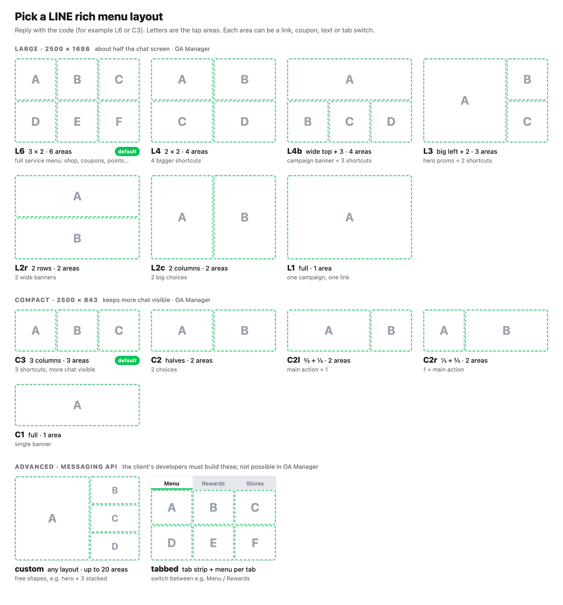

# Social Mockup Studio

**Realistic LINE, Facebook and TikTok mockups for any brand, on iPhone, Android and desktop, made by Claude.**

You describe the campaign in plain words. Claude asks a few questions, finds real photos, builds screens that look like real app screenshots, and gives you ready-to-use PNGs (and videos) for your slides.

**Version 1.0.0** · [What's new](CHANGELOG.md) · [All releases](https://github.com/Inno-Merkle-TH/social-mockup-skill/releases)

---

## ⬇️ Install

Takes about 2 minutes, once per computer. Pick the Claude you use:

| You use… | Install | Photos from the internet? |
|---|---|---|
| **Claude app** (chat on Mac/Windows, or claude.ai in the browser) | [Claude app ↓](#claude-app-chat-and-cowork) | ✗ You upload your own photos |
| **Cowork** (Claude doing tasks on your computer) | [Claude app ↓](#claude-app-chat-and-cowork) | ✓ Claude finds them for you |
| **Claude Code** (terminal / coding tool) | [Claude Code ↓](#claude-code) | ✓ Claude finds them for you. Best quality on a Mac |

### Claude app (chat and Cowork)

**1. Download the skill file**

### [⬇️ Download social-mockup-studio.skill](https://github.com/Inno-Merkle-TH/social-mockup-skill/releases/latest/download/social-mockup-studio.skill)

This link always gives you the newest version (about 8 MB). **Don't unzip or rename it.**

**2. Turn on file creation**
Claude → **Settings → Capabilities** → turn on **"Code execution and file creation"** (newer versions: **"Create and edit files"**).

**3. Upload the skill**
Go to **Customize → Skills**, click the **+** button, then **Create skill → Upload a skill**, and choose the file. Check the switch next to **social-mockup-studio** is **on**.

**4. Try it**
Start a **new chat** (or Cowork task) and type:
> Make a LINE OA mockup on iPhone for a coffee brand called Morrow Coffee: a morning promo message with the rich menu open.

Claude replies with questions? It's working. 🎉

> [!TIP]
> - **Upload refused?** Rename the file to `social-mockup-studio.zip` and upload that. It's the same file.
> - **Team or Enterprise plan?** Your admin may need to allow skills first: **Organization settings → Plugins & skills → Policy**.
> - **Don't use** GitHub's green **Code → Download ZIP** button. That's the source code, not the skill file.

### Claude Code

**1. Install with one command** (Mac or Linux). It downloads the latest version into `~/.claude/skills/` and installs the screenshot tool:

```bash
curl -fsSL https://github.com/Inno-Merkle-TH/social-mockup-skill/releases/latest/download/social-mockup-studio.skill -o /tmp/social-mockup-studio.zip \
  && mkdir -p ~/.claude/skills && rm -rf ~/.claude/skills/social-mockup-studio \
  && unzip -q /tmp/social-mockup-studio.zip -d ~/.claude/skills \
  && (cd ~/.claude/skills/social-mockup-studio/scripts && npm install)
```

Needs Node.js 18 or newer. Google Chrome is used automatically if it's installed.

**2. Try it.** Start Claude Code and ask, e.g. *"mock up a TikTok ad for our new drink on Android"*, or type `/social-mockup-studio`.

**Optional: more stock photos.** Add free API keys to your shell profile:
```bash
export PEXELS_API_KEY=...        # free at pexels.com/api
export UNSPLASH_ACCESS_KEY=...   # free at unsplash.com/developers
```

> [!TIP]
> - **Windows:** download the file from the [Claude app section](#claude-app-chat-and-cowork), unzip it, and move the `social-mockup-studio` folder into `%USERPROFILE%\.claude\skills\`. Then run `npm install` in its `scripts` folder.
> - **For a whole team project:** unzip into `<your-repo>/.claude/skills/` instead and commit that folder.
> - **Final client files: use a Mac.** Only macOS has the real iPhone fonts (SF Pro and Thonburi). Elsewhere, iPhone screens use a close look-alike.

### Updating to a new version

New versions are listed in [What's new](CHANGELOG.md). In Claude Code and Cowork, Claude also tells you in its first reply: *"A newer version of this skill (x.y.z) is out"*. Updating never touches your projects or finished mockups.

| You use… | How to update |
|---|---|
| **Claude app / Cowork** | 1. [Download the new file](https://github.com/Inno-Merkle-TH/social-mockup-skill/releases/latest/download/social-mockup-studio.skill) · 2. **Customize → Skills** → open **social-mockup-studio** → delete it · 3. Upload the new file and switch it on · 4. Start a new chat |
| **Claude Code** | Run the [install command](#claude-code) again. It replaces the old version. |

To check which version you have, ask Claude *"which version of social-mockup-studio are you using?"*

> [!IMPORTANT]
> **Installed with `git clone` before version 1.0.0?** The skill moved into a sub-folder of the repo, so your old copy stops working after `git pull`. Delete `~/.claude/skills/social-mockup-studio` and run the [install command](#claude-code) once.

---


## Contents

- [What you can make](#what-you-can-make)
- [Photos: who gets them?](#photos-who-gets-them)
- [How to use it](#how-to-use-it)
- [The questions Claude will ask you](#the-questions-claude-will-ask-you)
- [What you get](#what-you-get)
- [Asking for changes](#asking-for-changes)
- [Tips for the best results](#tips-for-the-best-results)
- [Troubleshooting](#troubleshooting)
- [Good to know](#good-to-know)
- [For maintainers](#for-maintainers)

---

## What you can make

| Platform | Screens | iPhone | Android | Desktop |
|---|---|:-:|:-:|:-:|
| **LINE** | Official Account chat, Flex message cards, promo images (rich messages), rich menus (all 12 official layouts plus tab style), lock-screen notifications | ✓ | ✓ | – |
| **Facebook** | Feed ad (single image), carousel, Stories, the home feed on facebook.com | ✓ | ✓ | ✓ |
| **TikTok** | For You in-feed ad, Spark Ad, product card ad, tiktok.com | ✓ | ✓ | ✓ |

**🎬 Walk-through videos.** Claude can also turn the screens into a short video on one phone. A notification arrives on a real-looking lock screen, a finger taps it, the app opens on its real launch screen, the rich menu slides up and a reply comes in. You get MP4 (slides, chat), 9:16 (phones) or a transparent `.mov` (video editors). Just ask, e.g. *"also make a video of the journey from the push to the reply"*. Videos need Claude Code or Cowork on a Mac. In chat you get a file that plays the animation in Chrome, which you can screen-record.

**📱 In a phone or screen only.** Each screen comes in a realistic phone, or as **just the screen**, like a real screenshot at the exact size a real iPhone or Galaxy produces.

**Why it looks real**

| | |
|---|---|
| **Phone frames** | Real iPhone 17 Pro and Samsung Galaxy S26 sizes |
| **App screens** | Header, buttons, fonts and spacing matched to real 2026 screenshots of each app |
| **Status bars** | Measured on real iOS 26 and One UI 8.5 screenshots, down to the battery percentage |
| **Logos** | The real LINE, Facebook, Meta and TikTok logos and app icons, copied from each brand's own artwork |
| **Lock and launch screens** | The iOS 26 lock screen with glass notifications; the real LINE, Facebook and TikTok screens shown while each app opens |
| **Fonts** | SF Pro and Thonburi on iPhone, Roboto on Android, TikTok's own font in TikTok |
| **Image shapes** | Correct per placement, e.g. Facebook feed 4:5 portrait, TikTok full screen |
| **Photos** | Your brand's photos, or real photos Claude finds online ([who gets them](#photos-who-gets-them)) |
| **Copy** | Thai or English, with correct Thai line breaks |

**All the rich-menu layouts.** This is the same picture Claude shows you when you ask for a rich menu:



---

## Photos: who gets them?

| You use… | Who provides the photos |
|---|---|
| **Claude chat** | **You.** Chat can't download images from websites |
| **Cowork** | **Claude** finds and downloads them into your project folder |
| **Claude Code** | **Claude** finds and downloads them. Nothing to set up |

Either way, Claude says in its **first reply** whether it can download photos in your setup, and exactly which files it needs from you if it can't.

**In chat: give Claude the photos**
1. Start your request. Claude lists exactly which photos it needs, with sizes (e.g. *logo, square PNG*; *rich message image 1040×1040*; *one photo per menu button*).
2. Save them to your computer: from the brand's website (right-click → **Save image as…**), your brand folder, Google Drive or the client's assets.
3. Attach them (**paperclip / +**, or drag into the message box). Use the largest version you have, ideally at least 1500 px wide.
4. Say which goes where, e.g. *"photo 1 is the hero, photo 2 for button A"*, or let Claude decide.

**In Cowork: Claude downloads them**
1. In the Claude Desktop app, switch to **Cowork**.
2. Start a task and choose (or create) a project **folder**, e.g. `Desktop/Client X mockups`.
3. Ask, e.g. *"…find real photos online"*. Claude searches the brand's website and free photo sites, saves the photos in your folder, and lists each source in `assets/credits.json`.
4. If Claude says a site is blocked: **Settings → Capabilities** → allow network access for code (or add the site to the allowed domains; on a company plan, ask your admin). Then say *"try again"*.

---

## How to use it

1. **Ask in plain words.** No need to say "skill" or "mockup":
   - *"Show how our LINE broadcast for the 11.11 sale will look on iPhone and Android."*
   - *"I need a Facebook feed ad and a Story for Brand X, Thai copy, for a pitch tomorrow."*
   - *"Visualise our CRM journey: welcome message, coupon reminder and birthday message on LINE."*
   - *"Make a TikTok product card ad on iPhone using this product photo"* (attach the photo).
2. **Answer Claude's questions.** Usually clickable choices. Not sure? Pick the one marked **(Recommended)**. [Full list below](#the-questions-claude-will-ask-you).
3. **Give what you have:** logos, brand guidelines, product photos, copy, a sketch. Anything missing, Claude finds, writes or marks "to be confirmed".
4. **Wait while Claude builds.** It sets up the project, finds and crops photos, builds each screen, takes high-res screenshots and checks them for broken images, text that doesn't fit and blurry photos.
5. **Review.** Claude shows the screens and lists anything still open (e.g. "price not confirmed yet").
6. **[Ask for changes](#asking-for-changes)** in normal words, then download the final files.

---

## The questions Claude will ask you

Claude only asks what it needs, and skips anything you already said.

**About the job**
- Platforms (LINE, Facebook, TikTok) and devices (iPhone, Android, desktop).
- **Which screens, and what's on each one?**
  - **You already know:** list them, e.g. *"1. LINE chat with the promo, 2. rich menu, 3. Facebook feed ad"*. Claude builds exactly that.
  - **You're exploring:** say *"help me plan"*. Claude asks your goal and audience, then suggests 2–3 storyboards (e.g. 3-screen lean, 5-screen standard, 8-screen full journey).
  - Or mix: name the screens you're sure of and let Claude suggest the rest.

  Claude repeats the final numbered list back before it builds.

**About the brand**
- Brand name and the account name to show.
- Logo, colours and fonts, or permission to take them from the brand's website.
- Where photos come from: you, the brand's website, or Claude finds them online ([who gets them](#photos-who-gets-them)).

**About the content**
- Who writes the copy, and in which language.
- Offer details: product, price, discount, dates, conditions. **Claude never makes these up.** Unknown details become clearly marked placeholders.
- Campaign dates, so every screen shows matching dates and times.

**For LINE chats (asked every time)**
- **Rich menu:** open (most common), collapsed (only the "Menu" bar), or none.
- **Messages:** only the new one (a brand-new chat), or previous messages too (a real, lived-in chat).
- **Rich message, Flex message, or both?** A rich message is one designed picture with the text inside. A Flex message is a white card with photo, real text and buttons. Claude shows a small drawing of each.

**For LINE rich menus**
- Large (half the screen) or compact (a smaller strip).
- Layout: Claude shows the picture of every layout. Reply with a code like **L6** or **C3**, or say "you choose".
- What goes in each button area, with photos or icons.
- The menu bar text ("Menu" or your own, up to 14 characters).

**About the output**
- Light or dark mode, safe-zone guides, and where to deliver the files.
- **In a phone, or the screen only?** Screen only = like a real screenshot (no phone body, no camera notch), at real screenshot size. Handy for your own device template or slides.
- **A video too?** If yes: which screens in which order, what gets tapped, and the format (MP4, 9:16, 16:9, or transparent `.mov`). No video unless you say yes.

> [!TIP]
> **In a hurry?** Say *"just go with the defaults"*: Android Galaxy, LINE with the rich menu open and previous messages, Facebook light mode, TikTok, Thai copy, and real photos found online (in chat it asks you for the photos).

---

## What you get

| File | Use it for |
|---|---|
| `captures/01-…png`, `02-…png` … | One screen each, transparent background, high resolution (3× for phones), ready for PowerPoint, Keynote or Figma |
| `captures/00-overview.png` | All screens on one board, for a quick review or email |
| `captures/video/<name>.mp4` | Only if you asked for a video. Also `.gif` (small preview) or `.mov` (transparent, for editors) if asked |
| `notes.md` | What was decided, what's still a placeholder, and where every photo came from |
| `assets/credits.json` | The source of each photo found online |

- **Claude app / web:** the files appear in the chat. Click to download, or ask *"zip everything for me"*.
- **Cowork:** ask Claude to save them where you want, e.g. *"put the final PNGs in my Desktop/Client X folder"*.
- **Claude Code:** in the project folder, under `captures/`.

> [!NOTE]
> - **If the screenshot tool can't run** in Claude's workspace, Claude says so in its first reply and gives you **one HTML file** (opens by double-click) plus the project ZIP. Open it in Google Chrome to see all screens. Claude also says plainly that it couldn't check them visually. For final high-res files, ask a teammate with Claude Code on a Mac to run the export.
> - **If Claude can't reach the brand's website or photo sites**, it asks you for specific files (logo, rich message image, menu tiles, brand colours, CTA wording) instead of using made-up artwork.
> - With the first delivery Claude lists its **"Assumptions to confirm"**. Reply to that list first; it saves several rounds of changes.

---

## Asking for changes

Just say what you want, as you would to a designer:

| Change | Say |
|---|---|
| Copy | *"Make the headline shorter and the price bigger."* · *"Translate everything to English."* |
| Look | *"Change screen 3 to dark mode."* · *"Same screens but on iPhone."* |
| LINE | *"Use a compact rich menu with 3 buttons instead."* · *"Show the previous messages above the new one."* |
| Photos | *"Swap the photo for something brighter, with people in it."* |
| More | *"Add a TikTok version of the same ad."* |
| Frame | *"Give me the screens without the phone frame."* (or *"…with rounded corners"*) |
| Video | *"In the video, hold longer on the reply and make it 9:16."* · *"Make the video open TikTok instead of LINE."* |

Claude rebuilds only what changed and re-exports the images (and the video, if there is one).

---

## Tips for the best results

- **Real offers only.** Give real prices, dates and conditions, or let Claude mark them as placeholders. Invented promotions are the number-one reason mockups get rejected.
- **Give your best photos.** Product and lifestyle shots of at least 1500 px make the biggest difference. Logos work best as PNG or SVG.
- **One story, one timeline.** For a journey, tell Claude the dates so status-bar times and "valid until" dates agree.
- **Keep LINE messages short.** With the rich menu open, only about a third of the screen shows messages.
- **Desktop Facebook** uses a 1920×1080 screen so the whole ad fits in one image.
- **Check at 100%.** Open the PNGs full size before sending them to the client.

---

## Troubleshooting

| Problem | What to do |
|---|---|
| Claude doesn't ask questions or ignores the skill | Check the skill is switched **on** (Customize → Skills), start a **new chat**, and say *"use the social-mockup-studio skill"*. |
| Uploading the skill file fails | Upload the original file (`.skill`, or renamed to `.zip`), not a folder. Check "Code execution and file creation" is on. On Team/Enterprise, ask your admin to allow skills. Server error? Try again later, or in the other app (web vs desktop). |
| Claude says a newer version is out | [Update](#updating-to-a-new-version). It takes a minute; your projects aren't affected. |
| "Can't download photos" or "no internet" | **Expected in a normal chat.** Attach your own photos, or use Cowork or Claude Code ([who gets them](#photos-who-gets-them)). In Cowork, allow network access for code in Settings → Capabilities. |
| A white line or gap at the edge of a picture | Usually it's in the uploaded file itself. Claude trims uploads automatically; if you still see one, say *"check the edges of the image on screen 2"*. |
| Something you asked for disappeared | It shouldn't happen: Claude must ask before removing anything. Point to it, e.g. *"bring back the text message above the image"*. |
| Rich message vs card looks wrong | Say which you want: a **rich message** (one designed picture) or a **Flex message** (white card with photo, text and buttons). |
| iPhone text looks slightly different | The real iPhone fonts only exist on Macs. For final files, export with Claude Code on a Mac. |
| A photo looks blurry or wrong | *"Replace the photo on screen 2 with a sharper one of …"*, or attach your own. |
| Text is cut off or overlaps | Tell Claude which screen. It checks this automatically, but copy changes can bring it back. |
| Asked for a video but only got an HTML file | Chat can't record video. Open the HTML in Chrome (it plays there) and screen-record it (Mac: ⇧⌘5 → Record Selected Portion), or ask a teammate with Claude Code on a Mac. In Claude Code, install ffmpeg once: `brew install ffmpeg`. |
| The real app has a new design | Send a fresh phone screenshot of the real app to the skill maintainer ([For maintainers](#for-maintainers)). |

---

## Good to know

- These mockups are for **internal reviews and client pitches**, not for publishing as real app screenshots.
- Photos found online are fine for internal mockups. Before anything is published, replace them with licensed or client-supplied photos; `credits.json` lists every one.
- LINE, Facebook, TikTok, their logos and app designs belong to their owners.
- Don't put real customers' names or personal data into mockups. Claude uses plausible made-up names.
- See [`LICENSES.md`](skills/social-mockup-studio/LICENSES.md) for the fonts, logos and files included.

---

## For maintainers

<details>
<summary>Folder map, releasing a new version, recalibrating, adding screens (click to open)</summary>

### Repo layout

The repo root holds this README, `CHANGELOG.md`, the preview images (`docs/`) and the release setup (`tools/`, `.github/`). **The skill itself is `skills/social-mockup-studio/`**, exactly what gets packed into the `.skill` file. Paths below are inside that folder; run commands from there.

| Path | What it is |
|---|---|
| `VERSION` | The skill's version (`1.0.0`). Claude reads it; the release checks it |
| `SKILL.md` | The workflow Claude follows (intake → scaffold → images → build → export → review → notes) |
| `assets/kit.css`, `kit.js`, `icons.svg`, `fonts/` | The kit: phone frames, status bars, LINE/FB/TikTok screens, official logos, fonts |
| `templates/gallery.html` | One ready-made example of every screen type (fictional brand "Morrow Coffee") |
| `templates/stock/` | Demo photos (Wikimedia Commons, see `credits.json`) |
| `templates/captures/` | Only `04-line-richmenu-templates.png` is kept (shown during intake); the rest is git-ignored |
| `references/` | Intake questions, platform rules, fonts and ratios, devices (status bars, lock screens, screen-only), realism rules, QA checklist, Thai notes, image sourcing, video flows |
| `references/screens/` | Real-app screenshots (local only, git-ignored) and `calibrate/` replica pages |
| `scripts/check_update.py` | Compares `VERSION` with the latest GitHub release; Claude runs it at the start of a project |
| `scripts/preflight.py` | Checks whether this computer can render, and whether the brand site and photo sites are reachable |
| `scripts/export.cjs` | Renders every screen to PNG and runs QA (`qa.json`) |
| `scripts/video.cjs` | Records each flow to MP4, transparent ProRes or GIF. Needs ffmpeg |
| `scripts/calibrate.cjs` | Overlays a rebuilt screen on a real phone screenshot and reports where they differ |
| `scripts/find_images.py`, `fetch_image.py` | Find and download real photos and log their sources |
| `scripts/clean_image.py` | Trims white edges off uploads (logged), checks sizes, makes an edge-zoom sheet |
| `scripts/bundle.py` | Packs a project into one HTML file and checks scripts, status bars and icons |
| `scripts/new_project.sh` | Creates a new project folder with the kit |
| `scripts/richmenu_picker.py` | Rebuilds `templates/richmenu-picker.svg`/`.png` (run with `--png` after changing rich menu layouts) |

### Releasing a new version

The `.skill` file isn't committed: GitHub builds it.

1. Make and test the changes in `skills/social-mockup-studio/`, then commit.
2. Bump `skills/social-mockup-studio/VERSION` (1.0.0 → 1.0.1 for fixes, 1.1.0 for new features, 2.0.0 when users must change how they work), and the version line at the top of this README.
3. Add a `## x.y.z (date)` section at the top of `CHANGELOG.md`, in plain words for users.
4. Test the package from the repo root: `python3 tools/build_skill.py --tag vx.y.z` (writes the git-ignored `dist/`).
5. Commit, then tag and push: `git tag vx.y.z && git push origin main vx.y.z`.

The `release` workflow (`.github/workflows/release.yml`) rebuilds the `.skill`, checks the tag matches `VERSION` and the changelog has notes, and publishes a GitHub release with the file attached. The download links in this README then serve the new version, and Claude starts telling users about it.

### Use without Claude

```bash
bash scripts/new_project.sh ~/work/acme-launch        # new project
# edit brand.css, add images, copy screens from templates/gallery.html into index.html
node scripts/export.cjs ~/work/acme-launch            # → captures/*.png + qa.json
node scripts/export.cjs ~/work/acme-launch --bare     # screen only (real screenshot size); --bare round keeps the corners
node scripts/video.cjs ~/work/acme-launch             # → captures/video/*.mp4 (flows only; needs ffmpeg)
python3 scripts/bundle.py ~/work/acme-launch          # → dist/acme-launch.html (one file, checked)
node scripts/export.cjs templates --root . --page gallery.html   # rebuild the gallery
```

Preview while editing: run `python3 -m http.server 8000` in the project's parent folder, then open `http://127.0.0.1:8000/acme-launch/`. Add `?only=<shot-id>` for one screen, `?safe=1` for safe zones, `?areas=1` for rich-menu tap areas, `?bare=1` for screen only.

### When an app changes its design

1. Put a real phone screenshot in `references/screens/device/`.
2. Copy the closest page in `references/screens/calibrate/`, then run
   `node scripts/calibrate.cjs references/screens/calibrate/<page>.html references/screens/device/<shot>.PNG`
3. Adjust `assets/kit.css` until the overlay lines up, mark the values `[V]`, re-export the gallery, commit, and [release](#releasing-a-new-version).

### Adding a new screen type

Instagram, Messenger, LINE VOOM…: add CSS to `kit.css`, an example to `gallery.html`, notes to the platform reference, then re-export, commit and release.

Keep client-specific material (client logos, paid fonts) **out** of this skill; it belongs in client projects.

</details>
